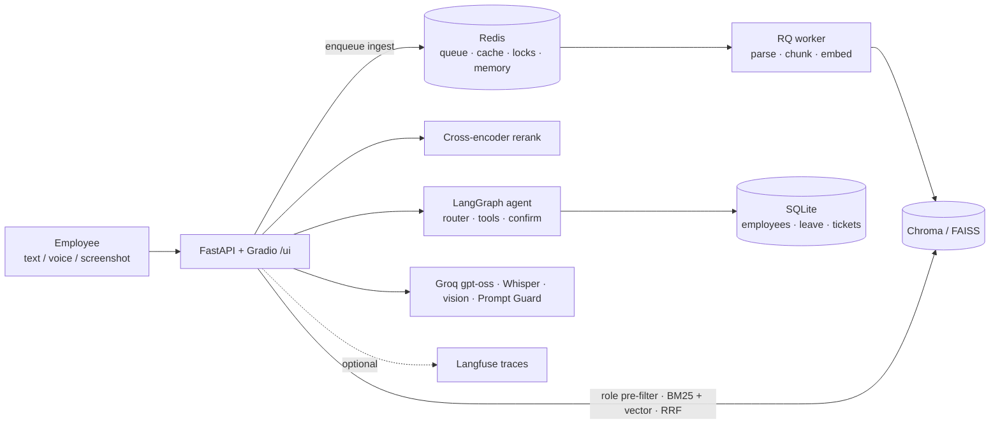

# OrbitDesk: enterprise helpdesk copilot (GenAI portfolio project)

OrbitDesk is a helpdesk copilot for **Orbit Systems, a fictional IT company**. Employees ask by text, voice or
screenshot; it answers only from 12 fictional HR policies and IT runbooks, with citations that the code checks
against what was actually retrieved. Retrieval is filtered by role *before* ranking, so an employee can never
retrieve the HR-only salary bands. An agent (LangGraph) checks leave balances and raises IT tickets, but only
after the user confirms, and exactly once. Every layer is measured: hybrid retrieval with reranking, guardrails,
caching, evals in MLflow, a fine-tuned router compared honestly against prompting, and CI that blocks a deploy if
retrieval quality or access control regresses.

**Live demo:** _(placeholder: https://huggingface.co/spaces/&lt;your-name&gt;/orbitdesk)_



## Key numbers (from `reports/`, rendered in [docs/EVAL_RESULTS.md](docs/EVAL_RESULTS.md))

| What | Result | Source |
|---|---|---|
| Retrieval recall@5 / MRR (40-question golden set) | 1.000 / 0.962 | `reports/retrieval_eval.json` |
| Access-control leaks, adversarial test | 0 in 198 queries | `reports/retrieval_eval.json` |
| No-answer accuracy (refuse iff unanswerable) | 0.95 with rerank vs 0.85 without (grid average) | `reports/grid_results.json` |
| Injection: direct blocked by regex layer / indirect dropped / benign false positives | 8/15 · 5/5 · 0/10 | `reports/safety_eval.json` |
| Bias: same top source across 8 names/genders x 5 templates | 1.00 | `reports/safety_eval.json` |
| Embedding batch 8 vs one-by-one | 1.59x | `reports/embedding_benchmark.json` |
| RAGAS faithfulness / relevancy, LLM latency, cost, cache hit rate, router comparison | **not measured yet: need a Groq key** | see [what's left](#status-whats-done-whats-stubbed) |

## Run locally

Requirements: Python 3.11 via [uv](https://docs.astral.sh/uv/) (`pip install uv`), optionally Docker Desktop.

```powershell
uv sync                                   # runtime + dev deps (CPU-only torch)
copy .env.example .env                    # every key may stay empty
uv run python scripts/ingest_all.py       # seed SQLite + index the 12 docs (local models, no key)
```

**Option A, no Docker (Windows-friendly):** in-process Redis and in-process ingestion jobs.

```powershell
$env:REDIS_URL="fakeredis://"; $env:QUEUE_MODE="inline"
uv run uvicorn app.main:app --port 8000   # http://localhost:8000/ui  (API docs: /docs)
```

**Option B, real services:** `docker compose up --build` (api, RQ worker, Redis, Chroma) -> http://localhost:8000/ui

With every key empty: ingestion, `/search`, the UI and the admin view work; `/ask`, `/agent`, `/voice`
and `/image` return **503** with a message saying which key is missing. Put `GROQ_API_KEY` in `.env` to
enable generation.

Quick API check:

```powershell
curl -X POST localhost:8000/search -H "content-type: application/json" -d '{\"query\":\"VPN-809\",\"role\":\"employee\"}'
curl -N -X POST localhost:8000/ask -H "content-type: application/json" -d '{\"question\":\"How many leave days can I carry over?\",\"session_id\":\"s1\",\"role\":\"employee\"}'
```

## Run the evals

```powershell
uv run pytest -q                                            # 88 tests, no keys needed
$env:REDIS_URL="fakeredis://"
uv run python evals/retrieval_eval.py --gate                # recall@5, MRR, leak test, CI gate (no key)
uv run --group eval python evals/grid.py                    # 32-config retrieval grid -> MLflow (no key)
uv run python evals/safety_eval.py                          # injection suite + bias check (no key)
uv run python evals/safety_eval.py --llm                    # + Prompt Guard + answer-level checks (key)
uv run --group eval python evals/generation_eval.py         # RAGAS, resumable on the free tier (key)
uv run python evals/perf_eval.py                            # latency per stage, tokens, cost, cache hits (key for full)
uv run python evals/render_results.py                       # re-render docs/EVAL_RESULTS.md from reports/
uv run --group eval mlflow ui --backend-store-uri sqlite:///mlruns/mlflow.db
```

Router fine-tuning (Phase 7): `finetune/generate_router_data.py` (key) -> hand-review
`finetune/data/test_review.csv` -> run `finetune/router_lora.ipynb` on a free Colab T4 -> put
`finetuned_predictions.json` into `finetune/results/` -> `finetune/compare_routers.py`.

## Docs

- [docs/ARCHITECTURE.md](docs/ARCHITECTURE.md): request flow for ingestion, `/ask`, `/agent`, `/voice`, `/image`
- [docs/DECISIONS.md](docs/DECISIONS.md): every choice, why, and the rejected alternative
- [docs/EVAL_RESULTS.md](docs/EVAL_RESULTS.md): numbers, generated from `reports/`
- [docs/DEPLOY.md](docs/DEPLOY.md): CI/CD, Space setup, monitoring, rollback
- [docs/INTERVIEW_MAP.md](docs/INTERVIEW_MAP.md): requirement-to-evidence map and interview answers
- [docs/PLAN.md](docs/PLAN.md): the original plan and every change made during the build

## Status: what's done, what's stubbed

| Area | Status |
|---|---|
| Ingestion, hybrid retrieval, role pre-filter, rerank, caching, guardrails, agent, memory, multimodal endpoints, UI, admin view, tracing hooks | Built and tested with fakes (no key). End-to-end LLM paths **not yet run against Groq**: no key was available during the build. |
| Retrieval evals, grid, leak test, safety (heuristic layer), bias (retrieval level), embedding benchmark | **Measured** |
| RAGAS, Prompt Guard layer, answer-level bias, LLM latency/cost, cache hit rate | Scripts ready; **not measured** (need `GROQ_API_KEY`) |
| Router fine-tuning | Data generator, notebook and comparison ready; training smoke-tested on CPU with a 16-example hand-written set; **real data + Colab run pending** |
| Docker image, compose | **Built and run locally**: container smoke test (no keys), real RQ worker ingestion, compose with all 4 services healthy (`reports/docker_smoke.json`) |
| HF Space deploy | Workflow ready; **needs your Space + `HF_TOKEN`** |
| k8s manifests | Written, **not tested on kind** |

All documents, employees and data are fictional.
