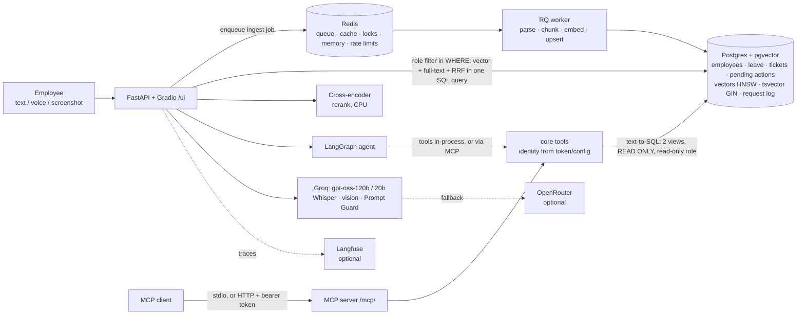
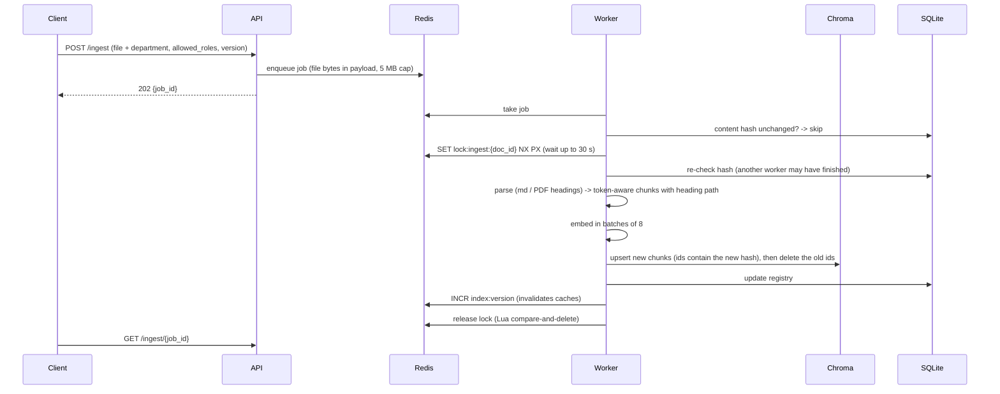
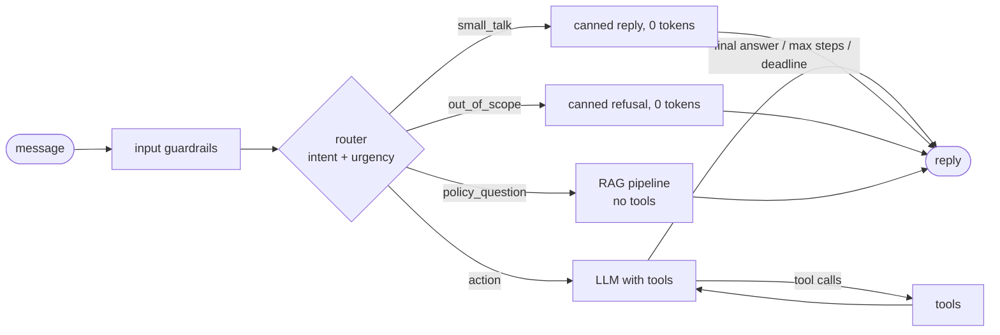

# Architecture

OrbitDesk is one FastAPI service (the Gradio UI is mounted at `/ui`, the MCP server at `/mcp/`), one RQ
worker, Redis, and Postgres with pgvector, which holds the mock enterprise systems (employees, leave, tickets,
pending actions), the request log, and the document vectors + full-text index. Without `DATABASE_URL` the same
code runs on SQLite + Chroma (FAISS is a third store for comparison). Embeddings and reranking run locally on
CPU; generation, speech-to-text and vision call Groq.



Source of each box: `app/api/*` (HTTP), `app/ui/*` (Gradio), `worker.py` + `app/ingest/*` (worker),
`app/retrieval/*` (search; `vectorstore/pgvector_store.py`, `llamaindex_retriever.py`), `app/llm/client.py`
(LLM + fallback), `app/db/*` (SQLAlchemy Core, Postgres or SQLite), `app/analytics/*` (text-to-SQL),
`app/mcp_server/*` (MCP),
`app/observability/*` (logs, stats, tracing).

## Ingestion (`POST /ingest`, worker, startup)



- Files: `app/api/ingest.py`, `app/ingest/jobs.py`, `app/ingest/pipeline.py`, `app/ingest/chunker.py`,
  `app/ingest/parsers.py`, `app/infra/locks.py`, `app/infra/queue.py`.
- At startup the API ingests `data/docs/manifest.yaml` in a background thread; unchanged docs are
  skipped by hash, so restarts cost seconds.

## `/ask` (streamed RAG)

1. **Rate limit** per session (Redis fixed window), then **input guardrails**: length cap, PII masking
   (the masked text is the only version used afterwards: LLM, cache key, logs, memory), injection check
   (regex heuristics, then Prompt Guard 2 on Groq). Blocked input gets a refusal without retrieval.
2. **Memory + rewrite**: recent turns + rolling summary from Redis. A heuristic decides whether the question
   is a follow-up or too vague; only then the small model rewrites it into a standalone query.
3. **Cache**: exact (normalised question) then semantic (cosine >= 0.95 and same numbers), both namespaced by
   index version + role + prompt version (+ department). A hit skips retrieval and generation (0 tokens).
4. **Hybrid retrieval with the role filter inside the search**: Chroma `where={"role_<role>": True}` and a
   per-role BM25 index, 20 candidates each, merged with Reciprocal Rank Fusion. Chunks that look like
   instructions to the AI (indirect injection) are dropped.
5. **Rerank** 20 -> 5 with the cross-encoder. If the best score is below the threshold, the answer is
   "I couldn't find this in the policies." and no LLM call is made.
6. **Generate** with `prompts/answer_<PROMPT_VERSION>.yaml`: context inside `<context>` / `<chunk>` tags,
   answer streamed over SSE, followed by a `---META---` JSON block (follow-up suggestions) that is never
   streamed. The output guard runs on the accumulated text while streaming and can cut the stream.
7. **Verify citations** `[doc_id, section]` against the retrieved chunks; invalid ones are removed.
   Confidence = sigmoid(top rerank score) x share of valid citations.
8. Return `AskResponse` (answer, citations, confidence, follow-ups, per-stage timings, tokens, est. cost),
   then store it in the cache, append to memory, and write a `request_log` row.

Files: `app/api/ask.py`, `app/rag/pipeline.py`, `app/rag/*`, `app/retrieval/*`, `app/guardrails/*`,
`app/cache/*`, `app/agent/memory.py`.

## `/agent` (LangGraph)



- Router: `ROUTER_MODE=prompt` (Groq gpt-oss-20b, few-shot) or `finetuned` (local Qwen2.5-0.5B + LoRA,
  falls back to prompt mode if the adapter can't load). Unparseable output routes to the read-only RAG path.
- Tools are built per request as closures over the trusted identity: `get_leave_balance` takes **no
  arguments**, so the model cannot ask for someone else's balance. `get_ticket_status` hides other users'
  tickets (same "not found" message, so existence isn't leaked).
- `create_ticket` only inserts a row into `pending_actions` (expires after 10 min) and returns a
  `confirmation_id`. `POST /agent/confirm` runs one transaction: `SELECT ... FOR UPDATE` on that row,
  `INSERT INTO tickets ... ON CONFLICT (idempotency_key) DO NOTHING RETURNING id`, then marks the action
  `executed`. A double click waits for the lock and gets the same ticket back with `status: duplicate`.
- IT admins also get `ticket_analytics` (text-to-SQL, below).
- `TOOLS_VIA_MCP=true`: `search_policies`, `get_ticket_status` and `ticket_analytics` are loaded from the MCP
  server with a 5-minute token minted for the current user; `get_leave_balance` and `create_ticket` stay local.
- Limits: `AGENT_MAX_STEPS`, an in-graph deadline checked before each LLM call, a hard wall-clock cap on
  the whole graph, and LangGraph's recursion limit. Every failure becomes a polite reply, never a 500.

Files: `app/agent/graph.py`, `router.py`, `tools.py`, `actions.py`, `memory.py`, `app/api/agent.py`.

## Text-to-SQL (`ticket_analytics`, IT admins only)

```mermaid
sequenceDiagram
    participant A as Agent / MCP client
    participant T as ticket_analytics
    participant L as LLM
    participant V as Validator (sqlglot)
    participant P as Postgres
    A->>T: question (+ identity from session/token)
    T->>T: role == it_admin? else refuse
    T->>L: schema of v_tickets + v_departments only, question
    L-->>T: one SELECT
    T->>V: parse: 1 statement, SELECT only, allowlisted views, no WITH/INTO/comments/;, safe functions
    V-->>T: SQL with LIMIT added or capped (or rejection reason)
    T->>P: BEGIN READ ONLY; SET LOCAL ROLE orbitdesk_analytics; SET LOCAL statement_timeout
    P-->>T: rows (role can only SELECT the two views)
    T-->>A: {sql, columns, rows}
```

On SQLite the database layer is `PRAGMA query_only` plus a progress-handler timeout (no roles).
Files: `app/analytics/text_to_sql.py`, `app/agent/core_tools.py`, `prompts/text_to_sql_v1.yaml`.

## MCP server (`/mcp/` and `python -m app.mcp_server`)

- Tools: `search_policies`, `get_ticket_status`, `ticket_analytics`, implemented by the same functions as the
  in-process agent tools (`app/agent/core_tools.py`).
- **stdio** (local clients such as Claude Desktop): identity from `MCP_EMPLOYEE_ID` + `MCP_ROLE`, checked
  against the employee record at startup; the server refuses to start if they don't match.
- **Streamable HTTP** (remote): mounted in the API at `/mcp/`, stateless. Every request needs
  `Authorization: Bearer <token>`; the SDK's auth middleware calls our `TokenVerifier`, which checks the HMAC
  signature and expiry. Tools read the caller from the verified token, never from their arguments.

Files: `app/mcp_server/server.py`, `auth.py`, `__main__.py`, `app/agent/mcp_tools.py`.

## `/voice`

Audio file (<= 25 MB) -> Groq Whisper (`whisper-large-v3-turbo`, `verbose_json` for duration and cost) ->
the transcript goes through the full `/ask` pipeline -> response has the transcript, STT latency and cost,
and the answer. Files: `app/api/multimodal.py`, `app/multimodal/stt.py`.

## `/image`

Screenshot (png/jpg/webp, <= 4 MB) -> vision model extracts `{error_code, error_message, application,
search_query}` -> `/ask` pipeline with `department="IT"`, so only IT runbooks are searched (filter inside
the vector search and BM25, on top of the role filter). The vision model is a preview model, so it
degrades: Groq vision -> OpenRouter vision (if `FALLBACK_PROVIDER_KEY`) -> HTTP 503
`image_input_unavailable` listing what was tried. Other endpoints are unaffected.
Files: `app/api/multimodal.py`, `app/multimodal/vision.py`.

## Reliability and limits in one place

| Concern | Mechanism | Where |
|---|---|---|
| Provider hiccup | `.with_retry()` exponential backoff + jitter, transient errors only | `app/llm/client.py` |
| Model gone / quota hit | `.with_fallbacks()`: 120b -> 20b -> OpenRouter | `app/llm/client.py` |
| Slow provider | per-call timeout; agent deadline + hard cap | `app/config.py`, `app/agent/graph.py` |
| Abuse | per-session rate limit, input length cap | `app/infra/ratelimit.py`, `app/rag/pipeline.py` |
| Duplicate work | per-document Redis lock + content hash; idempotent confirm | `app/infra/locks.py`, `app/agent/actions.py` |
| Stale answers | cache keys include the index version, bumped by every changed ingest | `app/cache/*` |
| LLM-written SQL | parsed-tree validator + READ ONLY transaction + read-only role + statement timeout | `app/analytics/text_to_sql.py` |
| Tool identity | closures over the session (in-process) or verified bearer token / server config (MCP) | `app/agent/tools.py`, `app/mcp_server/*` |
| No API key | every LLM endpoint returns 503 with a clear message; ingestion + `/search` work | `app/deps.py` |
